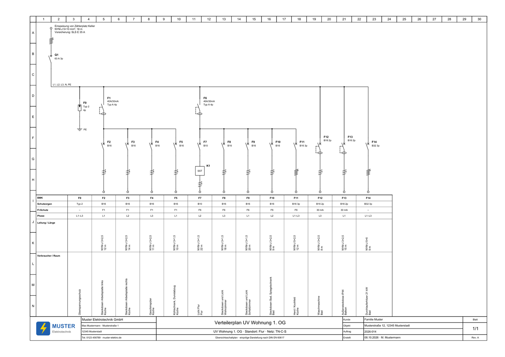
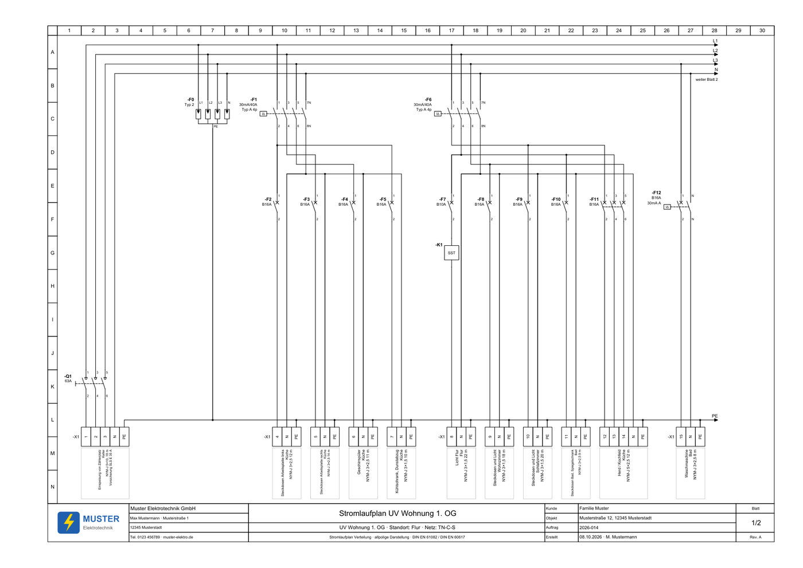
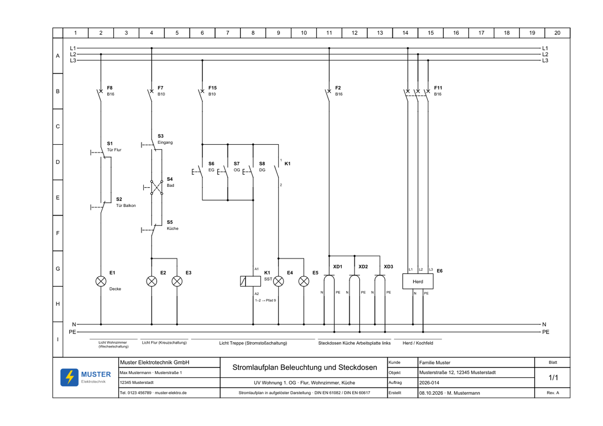
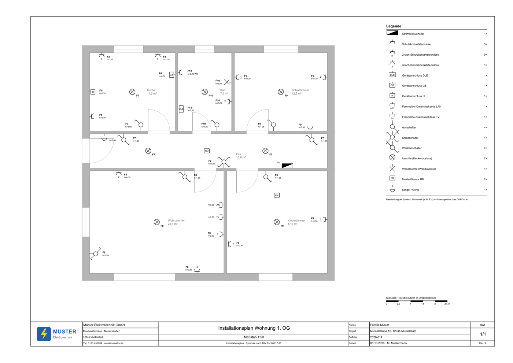
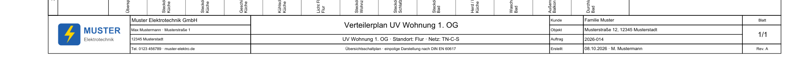

# elektroplan – Elektropläne mit Claude zeichnen

Ein Skill für [Claude Code](https://claude.com/claude-code), der Elektropläne nach **DIN EN 60617** zeichnet – mit **deinem eigenen Firmenschriftfeld und Logo**:

- **PDF** zum Drucken (A3 quer, A4 quer oder A4 hoch, maßstabsgetreu bei Druck in Originalgröße)
- **QElectroTech-Datei (.qet)** zum Weiterbearbeiten im kostenlosen [QElectroTech](https://qelectrotech.org)
- **Excel-Stromkreisliste** (Verteilerdokumentation mit Messprotokoll und Prüfbericht) in deinem Firmendesign

Du beschreibst den Plan in normaler Sprache, Claude erstellt ihn.



## Planarten

| Planart | Beispiel-Auftrag an Claude | Was Claude dafür braucht |
|---|---|---|
| **Verteilerplan** (Übersichtsschaltplan, einpolig) | „Mach mir den Verteilerplan aus dieser Stromkreisliste.“ | Ausgefüllte Excel-Stromkreisliste – oder die Schutzorgane einfach aufzählen |
| **Stromlaufplan der Verteilung** (allpolig) | „Stromlaufplan für die UV Wohnung OG“ | Dieselben Daten, am besten mit Phase je Stromkreis |
| **Stromlaufplan Installationsschaltungen** | „Kreuzschaltung im Flur mit 3 Schaltern, 2 Leuchten an F7 B10“ | Schaltungsart, LS, Phase, Anzahl Schalter/Leuchten |
| **Installationsplan** (Grundriss mit Symbolen) | „Installationsplan Küche 3,5 × 3,2 m, Tür unten rechts …“ oder Architekten-PDF mit Maßstab | Raummaße oder Grundriss, Geräte mit Stromkreis und Höhe |

Schaltungen im Stromlaufplan: Aus-, Serien-, Wechsel-, Kreuzschaltung, Stromstoßschaltung, Treppenlicht, Dimmer, Bewegungsmelder, Steckdosen, Herd/Drehstrom, Wendeschützschaltung und freie Strompfade.

| Stromlaufplan Verteilung | Installationsschaltungen | Installationsplan |
|---|---|---|
|  |  |  |

Alle Beispiele als PDF, .qet und Excel liegen im Ordner [`beispiele/`](beispiele/), alle Symbole im [Symbolkatalog](beispiele/Symbolkatalog.pdf).

Dazu prüft der Skill (nur als Hinweis, die Entscheidung bleibt bei dir): fehlender 30-mA-FI, LS zu groß für den Querschnitt, Polzahl zur Leitung, Stromkreise je FI, Spannungsfall > 3 %, Ausstattung nach DIN 18015-2, Installationszonen nach DIN 18015-3, Bereiche im Bad nach VDE 0100-701.

## Installation

Voraussetzungen: [Claude Code](https://claude.com/claude-code), **Python 3.9+**. Optional [QElectroTech](https://qelectrotech.org/download.php) zum Bearbeiten der .qet-Dateien.

### Variante A – als Plugin in Claude Code (empfohlen)

In Claude Code eingeben:

```
/plugin marketplace add julayyt/elektroplan
/plugin install elektroplan@elektroplan
```

Danach Claude Code neu starten und die Einrichtung aufrufen:

```
/elektroplan:einrichten
```

Updates holst du mit `/plugin marketplace update elektroplan` – deine Firmendaten bleiben dabei erhalten.

### Variante B – Installationsskript

**Windows** (PowerShell):

```powershell
irm https://raw.githubusercontent.com/julayyt/elektroplan/main/install.ps1 | iex
```

**macOS / Linux**:

```bash
curl -fsSL https://raw.githubusercontent.com/julayyt/elektroplan/main/install.sh | bash
```

Das Skript lädt den Skill herunter, kopiert ihn nach `~/.claude/skills/elektroplan`, installiert die Python-Pakete und startet direkt die Einrichtung im Terminal.

Wer das Repository lieber selbst herunterlädt (grüner Button **Code › Download ZIP** oder `git clone`): entpacken und `install.ps1` bzw. `install.sh` aus dem Ordner starten.

## Einrichtung: deine Firmendaten

Beim ersten Plan (oder mit `/elektroplan:einrichten`) fragt Claude nach:

| Angabe | Wofür |
|---|---|
| **Firmenname** (Pflicht) | Schriftfeld, Excel-Vorlage |
| Inhaber, Qualifikation, Anschrift, Telefon, E-Mail, Web | Schriftfeld, Fußzeile der Excel-Vorlage |
| **Logo** (PNG, JPG oder PDF) | Schriftfeld und Excel-Vorlage – Ränder werden automatisch beschnitten |
| Installateurverzeichnis, HWK-Betriebsnummer | Blatt „Anlage“ der Verteilerdokumentation |
| Kürzel „Erstellt von“, Akzentfarbe, Ablageordner | Schriftfeld, Excel-Design, wohin Claude die Pläne speichert |

Danach erzeugt der Skill ein **Testblatt**, damit du Schriftfeld und Logo prüfen kannst:



**Wo liegen die Daten?** Nur lokal auf deinem Rechner in `~/.elektroplan/` (Windows: `C:\Users\<Name>\.elektroplan\`) – getrennt vom Skill. Deshalb überschreibt ein Update deine Daten nicht, und es wandert nichts davon zurück ins Repository. Ändern geht jederzeit: „Ändere die Telefonnummer im Schriftfeld“ oder `/elektroplan:einrichten`.

Die Einrichtung geht auch ohne Claude im Terminal:

```bash
python ~/.claude/skills/elektroplan/scripts/einrichtung.py
```

Weitere Befehle: `status`, `logo <pfad>`, `vorlage`, `test`, `paket`, `zuruecksetzen` (siehe `einrichtung.py --help`).

### claude.ai statt Claude Code

Skills lassen sich auch in claude.ai hochladen (Einstellungen › Skills). Dort gibt es kein Home-Verzeichnis, deshalb erst lokal einrichten und dann ein persönliches Paket bauen:

```bash
python ~/.claude/skills/elektroplan/scripts/einrichtung.py paket
```

Das erzeugt `elektroplan-persoenlich.zip` (mit deinen Firmendaten) im Download-Ordner zum Hochladen. Dieses ZIP nicht weitergeben.

## So arbeitest du damit

- Pläne landen im Ordner, den du nennst (oder im Ablageordner aus der Einrichtung), Name `JJJJ-MM-TT <Planart> <Bezeichnung>`. Neben PDF und .qet liegt eine `.json` mit allen Plandaten – Änderungen sagst du Claude, der ändert die JSON und erzeugt neu.
- Hast du eine .qet in QElectroTech von Hand geändert, sag das Claude, bevor neu erzeugt wird – sonst wird sie überschrieben.
- Maßstäbe im Installationsplan stimmen nur bei Druck in **Originalgröße** (nicht „an Seite anpassen“).
- Mit `--stromkreisliste` füllt Claude zusätzlich deine Excel-Verteilerdokumentation aus; umgekehrt kann eine ausgefüllte Stromkreisliste direkt als Eingabe dienen.

## Aufbau

```
.claude-plugin/          Plugin- und Marketplace-Beschreibung für Claude Code
commands/einrichten.md   Befehl /elektroplan:einrichten
skills/elektroplan/      der eigentliche Skill
  SKILL.md               Anleitung für Claude
  scripts/               Python: Einrichtung, Planerzeugung, Symbole, Schriftfeld, Excel
  referenz/              JSON-Format, Fachliches, DIN-18015-Tabelle, Musterpläne
beispiele/               Beispielpläne der fiktiven „Muster Elektrotechnik GmbH“
install.ps1, install.sh  Installationsskripte
```

## Hinweise

- Der Skill ist ein Werkzeug für **Elektrofachkräfte**. Die Normhinweise ersetzen keine Bemessung, Prüfung oder Dokumentation nach VDE. Die Tabelle zu DIN 18015-2 ist noch nicht mit dem Normtext abgeglichen (`"geprueft": false`) – Korrekturen sind willkommen.
- Die Symbole sind eigene Zeichnungen nach DIN EN 60617, eingebettet in jede .qet-Datei.
- Fehler gefunden oder ein Symbol fehlt? Gern ein [Issue](https://github.com/julayyt/elektroplan/issues) oder einen Pull Request.

## Lizenz

[MIT](LICENSE)
